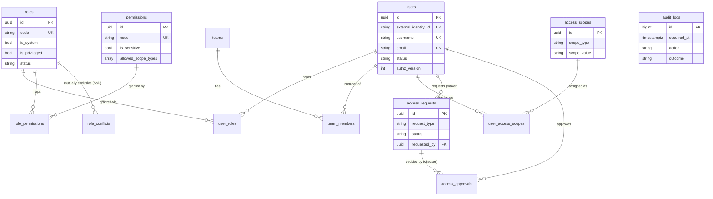

# Identity & Access Service (IAM)

Independent identity-and-authorization microservice for the Bank Collection Management System (CMS).
It owns the PostgreSQL schema **`iam`** and nothing else, and is consumed over REST by the other CMS services
(policy-strategy, delinquency, collections, communication, reporting, future AI services) so that **no other service ever
reads IAM tables**.

> Fictional data only. Roles/permissions are CMS design assumptions, not Allied Bank Pakistan's real access policy.

## 1. Responsibilities

| In scope | Out of scope |
|---|---|
| Users (identity mapping to an external OIDC subject, status), roles, permissions, user-role and role-permission mapping | Passwords / credentials / MFA (delegated to the bank's OIDC provider) |
| Teams, memberships, access scopes (OWN/TEAM/BRANCH/REGION/PORTFOLIO/GLOBAL) | Business data (cases, policies...) - owned by other services |
| Authorization decisions (RBAC + scope) for IAM itself and for other services | Enforcing permissions *inside* other services (they call IAM / use the contract below) |
| Maker-checker for privileged changes, append-only security audit | Real bank SSO integration (configurable, provider-agnostic) |

## 2. Project structure

```text
services/identity-access-service/
├── app/
│   ├── main.py                    # app factory (docs gating, CORS, request-id middleware, routers under /api/v1)
│   ├── cli.py                     # operator CLI: bootstrap-admin
│   ├── api/deps.py                # token -> Principal, require_permission(...)
│   ├── api/v1/                    # users, roles, permissions, teams, scopes, access_requests, authorization, audit, health
│   ├── core/                      # config (pydantic-settings), database, security (Principal), exceptions, logging
│   ├── domain/                    # models (SQLAlchemy), enums, policies.py (pure RBAC+scope evaluation, maker-checker triggers)
│   ├── application/               # user/role/permission/team/scope/access/authorization services (business rules)
│   ├── infrastructure/            # identity_provider.py (OIDC/JWKS validation), audit_repository.py
│   └── schemas/                   # Pydantic v2 request/response models
├── migrations/                    # Alembic (version table: iam.alembic_version_iam)
├── scripts/db/init_iam_roles.sql  # one-off DBA script: iam_migrator / iam_user roles + schema grants
├── tests/{unit,integration,security}
├── Dockerfile, docker-compose.dev.yml, requirements.lock, pyproject.toml, .env.example
../../data_seed/seed/identity/     # ALL IAM seed data lives in the repo's existing seeding package
```

There is intentionally no repository layer: services use SQLAlchemy directly (avoids boilerplate; the ORM already is the abstraction).

## 3. Dependencies

Python >= 3.11 (developed on 3.12), FastAPI, SQLAlchemy 2 (sync) + psycopg 3, Alembic, Pydantic v2 + pydantic-settings,
PyJWT[crypto], httpx, Typer; dev: pytest, Ruff. Sync SQLAlchemy matches the existing `data_seed` module; FastAPI runs the
sync endpoints in its thread pool. `requirements.lock` pins the runtime closure used by the Docker image.

```bash
cd services/identity-access-service
python3.12 -m venv .venv && source .venv/bin/activate
pip install -e ".[dev]"
```

## 4. Database configuration

Configuration is read from the process environment, then `services/identity-access-service/.env` (git-ignored; see `.env.example`).
Credentials are never logged or printed. `DATABASE_URL` uses the **runtime** role; Alembic uses `MIGRATION_DATABASE_URL`
(falls back to `DATABASE_URL`).

| Role | Purpose | Privileges |
|---|---|---|
| `iam_migrator` | DDL via Alembic | owns schema `iam` |
| `iam_user` | service runtime + seeding | `USAGE` on `iam`; `SELECT/INSERT/UPDATE/DELETE` on tables; **only `SELECT, INSERT` on `audit_logs`**; no access to any other schema |

**One-time setup by a DBA/superuser** (passwords are psql variables, never stored in the script):

```bash
psql -d bank-cms -v migrator_pw="'<generated>'" -v runtime_pw="'<generated>'" -f scripts/db/init_iam_roles.sql
```

then put the `iam_user` URL into `.env` (`postgresql+psycopg://iam_user:<runtime_pw>@localhost:5432/bank-cms`, URL-encode special
characters). If PostgreSQL runs in Docker use the Compose service name / `host.docker.internal` instead of `localhost`.
The script and the migrations only touch schema `iam`; other services' schemas and Alembic histories are never modified.

## 5. Migrations

```bash
export MIGRATION_DATABASE_URL=postgresql+psycopg://iam_migrator:<pw>@localhost:5432/bank-cms
alembic upgrade head            # creates 13 tables + iam.alembic_version_iam
alembic check                   # models == schema (no drift)
alembic downgrade base          # drops IAM tables only
```

Tables: `users, roles, permissions, role_permissions, role_conflicts, user_roles, teams, team_members, access_scopes,
user_access_scopes, access_requests, access_approvals, audit_logs`. No cross-service foreign keys: other services store IAM
user UUIDs by value only. `audit_logs` has no FKs (history outlives entities) and a trigger rejects every `UPDATE`/`DELETE`.

### ER diagram



## 6. Authentication architecture

Authentication ("who are you?") is **delegated to an external OIDC provider**; IAM stores no passwords.

* Clients send `Authorization: Bearer <access token>`.
* `infrastructure/identity_provider.py` validates every token: **signature** (keys from the provider JWKS), **issuer**, **audience**,
  **expiry** (small configurable leeway), and requires `exp, iss, aud, sub`. Accepted algorithms are a server-side allow-list of
  *asymmetric* algorithms (default `RS256, ES256`); `none` and `HS*` (algorithm-confusion) are rejected, and the settings validator
  refuses to start with symmetric algorithms.
* JWKS is discovered from `<issuer>/.well-known/openid-configuration` (discovered `issuer` must match) unless `OIDC_JWKS_URL` is set;
  keys are cached (`JWKS_CACHE_TTL_SECONDS`), unknown `kid`s trigger a *throttled* refresh, and an IdP outage keeps serving cached keys but
  fails closed when none are cached.
* **Identity mapping:** token `sub` -> `iam.users.external_identity_id`. Unknown and deactivated users get an *identical* `403`
  (no user enumeration). All token failures return the same generic `401`.
* **Service identities:** a token whose `sub` is listed in `SERVICE_SUBJECTS` (client-credentials tokens of trusted CMS services)
  is a service principal. It may call `POST /authorization/check` for any user and nothing else. Such subjects cannot be registered as users.
* In `production` the app refuses to start without `OIDC_ISSUER`/`OIDC_AUDIENCE`, and requires https issuer/JWKS URLs.
  If OIDC is not configured outside production, protected endpoints fail closed with `503`.

### Connecting a bank-approved OIDC provider

1. Register IAM as a resource server/audience in the provider; note the issuer URL and audience.
2. Register each consuming CMS service as a confidential client (client-credentials) and put its token `sub` in `SERVICE_SUBJECTS`.
3. Set `OIDC_ISSUER`, `OIDC_AUDIENCE` (and `OIDC_JWKS_URL` if discovery is not exposed), `OIDC_ALGORITHMS` to what the provider signs with.
4. Make the provider's stable user identifier the token `sub`; create IAM users with that value as `external_identity_id`.
5. Bootstrap the first two administrators (below). No code change is needed.

### Local development login

`docker-compose.dev.yml` starts a [mock OIDC server](https://github.com/navikt/mock-oauth2-server) (**development only**: it issues a token for
*any* requested subject, which is exactly why it must never be deployed). Seeded demo users have `external_identity_id = demo-<username>`:

```bash
curl -s -X POST localhost:8081/default/token -d grant_type=client_credentials \
     -d client_id=demo-sysadmin001 -d client_secret=x -d scope=bank-cms-iam     # -> access_token (sub=demo-sysadmin001, aud=bank-cms-iam)
```

There are no hardcoded JWT secrets, no password logins and no admin bypass endpoints anywhere in the service.

## 7. RBAC design

`User -> Roles -> Permissions` through `user_roles` and `role_permissions`; never booleans on users.

* **Permission catalog is seed-managed and read-only over the API** (`GET /permissions` only): nobody can invent a permission.
  Each permission carries `is_sensitive` and optional `allowed_scope_types`.
* **System roles** (the 10 business roles) cannot be renamed or deactivated, and their permission sets change only through an approved
  access request. Custom roles can be created (always non-system, non-privileged) and edited.
* **Privileged roles** (`is_privileged`: System Administrator, Policy Administrator, Policy Approver, Compliance Auditor) can only be assigned through maker-checker.
* **Separation of duties** (`role_conflicts`): e.g. Policy Administrator <-> Policy Approver (authors cannot approve), System Administrator <-> every collection role and Policy roles
  and Auditor. Enforced at request time *and* at apply time.
* Time-bound grants: `valid_until` on role and scope assignments; expired or revoked grants, inactive roles/scopes/users contribute nothing.
* Administrative IAM permissions (`iam.*`) are disjoint from business permissions: **System Administrators receive no case, policy or financial access.**

## 8. Scope-based authorization

RBAC says *what kind* of action; scopes say *on whose data*. A decision is allowed only if **(a)** the user is active, **(b)** an active
role grants the permission, and **(c)** for resource-scoped permissions, one of the user's active scopes - of a type that permission allows - covers
the **trusted** resource attributes. Default is deny, with a reason code.

| Scope | Matches resource attribute | Example |
|---|---|---|
| `OWN` | `assigned_user_id` == the user's IAM id | agent reads own cases |
| `TEAM` | `assigned_team_id` == scope value | supervisor reads `TEAM-001` |
| `BRANCH` / `REGION` / `PORTFOLIO` | `branch_id` / `region_id` / `portfolio_id` == scope value | manager reads `PF-CARDS` |
| `GLOBAL` | any | auditor / executive |

Granting `OWN/TEAM/BRANCH` is direct; **widening to `REGION/PORTFOLIO/GLOBAL` requires approval**. Scope values must be predefined in `access_scopes`
(`POST /scopes` validates type/value shape; `TEAM` scopes must reference an existing team and are created automatically with the team).

## 9. Maker-checker

```text
Requested (iam.access.request) -> validated -> PENDING -> independent checker (iam.access.approve) -> APPLIED | REJECTED | FAILED -> audit
```

Request types: `ASSIGN_ROLE`, `GRANT_SCOPE`, `GRANT_ROLE_PERMISSION`, `REVOKE_ROLE_PERMISSION`. Direct endpoints answer `409 approval_required`
for: privileged roles, REGION/PORTFOLIO/GLOBAL scopes, sensitive permissions on any role, and any change to a system role's permissions.

Rules enforced in code **and** covered by tests: the requester *and the beneficiary* can never decide the request (`separation_of_duties`);
the decision row, the change and the status flip happen in one transaction (savepoint); the request row is locked `FOR UPDATE`, so duplicate or concurrent
approvals apply exactly once (the rest get `409 request_not_pending`); rejection changes nothing; if state changed after the request (e.g. user deactivated)
the request ends `FAILED` with a reason and nothing is applied; nobody can directly assign roles/scopes to themselves or widen a role they hold.
The checker is *whoever holds `iam.access.approve`* (MVP: System Administrators, a second person); change the governance by remapping that permission - no code change.
Note: two cooperating administrators can still escalate each other - that is inherent to two-person control; see §17.

## 10. Role-permission matrix

`●` = granted by the seed. `*` = future role. Sensitive permissions need maker-checker to be mapped to a role and are never cacheable by consumers.

| Permission | Sensitive | Scope types | Agent | Supervisor | Manager | Policy Admin | Policy Approver | Sys Admin | Legal* | Hardship* | Auditor* | Executive* |
|---|---|---|---|---|---|---|---|---|---|---|---|---|
| `policy.read` |  | - |  |  | ● | ● | ● |  |  |  | ● | ● |
| `policy.create` |  | - |  |  |  | ● |  |  |  |  |  |  |
| `policy.update_draft` |  | - |  |  |  | ● |  |  |  |  |  |  |
| `policy.delete_draft` |  | - |  |  |  | ● |  |  |  |  |  |  |
| `policy.simulate` |  | - |  |  |  | ● |  |  |  |  |  |  |
| `policy.submit` |  | - |  |  |  | ● |  |  |  |  |  |  |
| `policy.approve` | yes | - |  |  |  |  | ● |  |  |  |  |  |
| `policy.reject` |  | - |  |  |  |  | ● |  |  |  |  |  |
| `policy.activate` | yes | - |  |  |  |  | ● |  |  |  |  |  |
| `policy.view_audit` |  | - |  |  |  | ● | ● |  |  |  | ● |  |
| `iam.user.read` |  | - |  |  |  |  |  | ● |  |  | ● |  |
| `iam.user.create` |  | - |  |  |  |  |  | ● |  |  |  |  |
| `iam.user.update` |  | - |  |  |  |  |  | ● |  |  |  |  |
| `iam.user.deactivate` |  | - |  |  |  |  |  | ● |  |  |  |  |
| `iam.role.read` |  | - |  |  |  |  |  | ● |  |  | ● |  |
| `iam.role.create` | yes | - |  |  |  |  |  | ● |  |  |  |  |
| `iam.role.update` | yes | - |  |  |  |  |  | ● |  |  |  |  |
| `iam.permission.read` |  | - |  |  |  |  |  | ● |  |  | ● |  |
| `iam.permission.assign` | yes | - |  |  |  |  |  | ● |  |  |  |  |
| `iam.user_role.assign` | yes | - |  |  |  |  |  | ● |  |  |  |  |
| `iam.user_role.revoke` | yes | - |  |  |  |  |  | ● |  |  |  |  |
| `iam.team.read` |  | - |  | ● | ● |  |  | ● |  |  | ● |  |
| `iam.team.manage` |  | - |  |  |  |  |  | ● |  |  |  |  |
| `iam.scope.read` |  | - |  |  |  |  |  | ● |  |  | ● |  |
| `iam.scope.assign` | yes | - |  |  |  |  |  | ● |  |  |  |  |
| `iam.access.request` |  | - |  | ● | ● |  |  | ● |  |  |  |  |
| `iam.access.approve` | yes | - |  |  |  |  |  | ● |  |  |  |  |
| `iam.audit.read` | yes | - |  |  |  |  |  | ● |  |  | ● |  |
| `case.read_assigned` |  | OWN | ● | ● |  |  |  |  | ● | ● |  |  |
| `case.read_team` |  | TEAM |  | ● | ● |  |  |  |  |  |  |  |
| `case.read_portfolio` |  | PORTFOLIO, BRANCH, REGION, GLOBAL |  |  | ● |  |  |  |  |  | ● |  |
| `case.create` |  | OWN, TEAM |  | ● |  |  |  |  |  |  |  |  |
| `case.update` |  | OWN, TEAM | ● | ● |  |  |  |  |  | ● |  |  |
| `case.assign` |  | TEAM, BRANCH, REGION |  | ● | ● |  |  |  |  |  |  |  |
| `case.escalate` |  | OWN, TEAM | ● | ● |  |  |  |  |  |  |  |  |
| `ptp.create` |  | OWN, TEAM | ● | ● |  |  |  |  |  |  |  |  |
| `ptp.read` |  | OWN, TEAM, PORTFOLIO | ● | ● | ● |  |  |  | ● | ● |  |  |
| `ptp.update` |  | OWN, TEAM | ● | ● |  |  |  |  |  | ● |  |  |
| `communication.read` |  | OWN, TEAM, PORTFOLIO | ● | ● | ● |  |  |  | ● | ● | ● |  |
| `communication.create` |  | OWN, TEAM | ● | ● |  |  |  |  |  | ● |  |  |
| `report.view_team` |  | TEAM |  | ● | ● |  |  |  |  |  |  |  |
| `report.view_portfolio` |  | PORTFOLIO, REGION, GLOBAL |  |  | ● |  |  |  |  |  | ● | ● |
| `recovery.read` |  | OWN, PORTFOLIO, REGION, GLOBAL |  |  |  |  |  |  | ● |  | ● |  |
| `recovery.review` | yes | OWN, PORTFOLIO, REGION, GLOBAL |  |  |  |  |  |  | ● |  |  |  |

Seeded scopes for the demo personas: agents `OWN`; supervisors `TEAM-00x`; manager `TEAM-001/002` + `PF-PERSONAL-LOAN/PF-CARDS`; auditor/executive `GLOBAL`.
There is deliberately **no** "Integration / Support Engineer" role.

## 11. API

Base path `/api/v1`. All endpoints except `/health/*` require a Bearer token; every protected endpoint additionally enforces a permission (deny by default).
Swagger UI: `http://localhost:8000/docs` (development/test; **disabled in production** unless `ENABLE_API_DOCS=true`).

| Area | Endpoints | Permission |
|---|---|---|
| Users | `POST/GET /users`, `GET/PATCH /users/{id}`, `POST /users/{id}/deactivate|reactivate` | `iam.user.create/read/update/deactivate` |
| Roles | `POST/GET /roles`, `GET/PATCH /roles/{id}` | `iam.role.create/read/update` |
| Permissions | `GET /permissions`, `GET/POST /roles/{id}/permissions`, `DELETE /roles/{id}/permissions/{pid}` | `iam.permission.read/assign` |
| User roles | `GET/POST /users/{id}/roles`, `DELETE /users/{id}/roles/{rid}` | `iam.role.read`, `iam.user_role.assign/revoke` |
| Teams | `POST/GET /teams`, `GET/PATCH /teams/{id}`, `GET/POST /teams/{id}/members`, `DELETE /teams/{id}/members/{uid}` | `iam.team.read/manage` |
| Scopes | `GET/POST /scopes`, `GET/POST /users/{id}/scopes`, `DELETE /users/{id}/scopes/{sid}` | `iam.scope.read/assign` |
| Authorization | `GET /me`, `GET /me/permissions`, `POST /authorization/check` | any active user / service identity (see §16) |
| Access requests | `POST/GET /access-requests`, `GET /access-requests/{id}`, `POST .../approve|reject` | `iam.access.request` / `iam.access.approve` |
| Audit | `GET /audit-logs` (filters: action, actor, target, outcome, date range) | `iam.audit.read` |
| Health | `GET /health/live`, `GET /health/ready` | public, no detail leaked |

Extras beyond the brief: `GET /scopes`, `POST /scopes`, `GET /teams/{id}/members`, and permissions `iam.scope.read/assign` (needed to manage scopes safely).
List endpoints take `limit` (1-200, default 50) and `offset` and return `{items,total,limit,offset}`.
Errors always look like `{"error": {"code", "message", "request_id"}}` (400/401/403/404/409/422; validation errors never echo submitted values).
Conflict codes worth handling: `approval_required`, `system_role_protected`, `role_conflict`, `separation_of_duties`, `request_not_pending`.

### Example requests

```bash
TOKEN=...   # bearer token for a System Administrator
curl -X POST localhost:8000/api/v1/users -H "Authorization: Bearer $TOKEN" -H 'Content-Type: application/json' \
  -d '{"external_identity_id":"oidc-sub-1","username":"agent900","display_name":"Example Agent","email":"agent900@example.invalid"}'

# privileged role -> must go through maker-checker
curl -X POST localhost:8000/api/v1/access-requests -H "Authorization: Bearer $TOKEN" -H 'Content-Type: application/json' \
  -d '{"request_type":"ASSIGN_ROLE","target_user_id":"<uuid>","role_id":"<POLICY_APPROVER uuid>","justification":"Covering approver leave, ticket 123"}'
# a DIFFERENT administrator approves (this call as the requester returns 403 separation_of_duties)
curl -X POST localhost:8000/api/v1/access-requests/<id>/approve -H "Authorization: Bearer $OTHER_ADMIN_TOKEN" -d '{"comment":"verified"}' -H 'Content-Type: application/json'

# service-to-service decision (caller token's sub must be in SERVICE_SUBJECTS)
curl -X POST localhost:8000/api/v1/authorization/check -H "Authorization: Bearer $SERVICE_TOKEN" -H 'Content-Type: application/json' \
  -d '{"subject":"oidc-sub-1","permission":"case.read_team","resource":{"case_id":"CASE-10001","assigned_team_id":"TEAM-001","branch_id":"BR-001"}}'
# -> {"allowed":true,"reason":"allowed","matched_scope":{"scope_type":"TEAM","scope_value":"TEAM-001"},"authz_version":7,"cache_ttl_seconds":60,...}
```

## 12. Running the service

```bash
cp .env.example .env                                  # fill DATABASE_URL (iam_user), OIDC_* ; never commit .env
alembic upgrade head                                  # as iam_migrator (MIGRATION_DATABASE_URL)
cd ../../data_seed && python -m seed.cli identity seed [--demo-users]   # reference data (+ DEV-ONLY fictional users)
cd ../services/identity-access-service
uvicorn app.main:factory --factory --reload           # http://localhost:8000/docs
# Docker (dev, with mock OIDC):  IAM_DOCKER_DATABASE_URL=... docker compose -f docker-compose.dev.yml up --build
```

**Bootstrapping real administrators** (no shared secret, no default admin): after the catalog is seeded, an operator with DB access runs, once per person
(maker-checker needs at least two):

```bash
python -m app.cli bootstrap-admin --subject <their OIDC sub> --username <name> --email <addr> --display-name "<name>"
```

The account is bound to the OIDC subject, so they still authenticate through the bank's IdP. Every run is audited.

## 13. Tests

```bash
export TEST_DATABASE_URL=postgresql+psycopg://<user>@127.0.0.1:5432/postgres   # a role allowed to CREATE DATABASE; any server you can throw data away on
pytest                    # 217+ tests; creates and drops its own disposable database, never touches bank-cms
pytest tests/unit         # no database needed
ruff check app tests
```

Without `TEST_DATABASE_URL` the DB tests are skipped (visibly), never silently passed. A disposable server is e.g.
`docker run --rm -p 55432:5432 -e POSTGRES_HOST_AUTH_METHOD=trust postgres:16` with `TEST_DATABASE_URL=postgresql+psycopg://postgres@127.0.0.1:55432/postgres`.
Layout: `tests/unit` (policy engine, token validation, JWKS handling, schemas), `tests/integration` (API + database: integrity, concurrency, audit, Alembic up/down/no-drift,
seed idempotency), `tests/security` (every endpoint requires auth, deny-by-default, token failure modes, privilege-escalation attempts, error hygiene).

## 14. Seed data

`data_seed/seed/identity/` (the repo's single seeding package): `roles.py` (10 roles + SoD conflicts), `permissions.py` (44-permission catalog), `role_permissions.py`, `teams.py`
(3 fictional teams, branch/region/portfolio/global scopes), `demo_users.py` (14 fictional dev users, `@example.invalid`, no passwords exist), `runner.py`.
Seeding is idempotent (upsert on stable codes), additive for role-permission links (re-seeding never silently removes an approved grant, never reactivates a deactivated system role),
uses the IAM service's own DB credentials (`IAM_DATABASE_URL` or this service's `.env`), and **demo users refuse to seed unless `APP_ENV` is `development`/`test`**.

## 15. Consistency and revocation behaviour

| Consumer path | Freshness | Revocation takes effect |
|---|---|---|
| IAM's own endpoints | Evaluated live against the database on every request | Immediately |
| `POST /authorization/check` | Live | Immediately |
| Consumer-side cache of an **allowed, non-sensitive** decision | Response carries `cache_ttl_seconds` (default 60) and `authz_version` | Within `cache_ttl_seconds` |
| **Sensitive** permissions (`is_sensitive`) and every deny | `cache_ttl_seconds = 0` - consumers must call IAM each time | Immediately |
| Roles baked into a token | Not used: tokens carry identity only, so a stale token cannot retain privileges | n/a |

Every change to a user's effective access (role/scope grant or revoke, role-definition change, deactivation) bumps `users.authz_version`;
consumers can use it to invalidate cached entries. Net effect: a revoked privileged role stops working immediately for sensitive actions and for IAM itself, and within `cache_ttl_seconds`
for cached non-sensitive decisions. A deactivated user is refused by IAM immediately; other services that validate tokens locally keep
accepting the *identity* until the access token expires, which is why they must still ask IAM before authorizing (§16).

## 16. Integrating other microservices

1. **Authenticate the end user** yourself: validate the bearer token against the same OIDC issuer/JWKS (same checks as §6). Take only `sub` from it.
2. **Fetch resource attributes from your own authoritative store** (never from the request body): `assigned_user_id` (IAM user UUID), `assigned_team_id`, `branch_id`, `region_id`, `portfolio_id`.
3. **Ask IAM** with your *service* token: `POST /api/v1/authorization/check {"subject": <sub>, "permission": "...", "resource": {...}}`; require `allowed == true`.
4. **Fail closed**: if IAM is unreachable, times out or returns anything unexpected, deny (return 503/403) - never fall back to allow. Cache only `allowed && cache_ttl_seconds > 0`
   decisions, keyed by (subject, permission, resource attributes), for at most `cache_ttl_seconds`, and drop entries when you observe a higher `authz_version`.
5. Store IAM user UUIDs as plain columns (`created_by`, `assigned_to`) - **no foreign keys** into `iam`.

```python
# illustrative consumer helper (kept out of this repo on purpose: a shared client library would couple services)
async def require_permission(sub: str, permission: str, resource: dict) -> None:
    try:
        r = await iam.post("/api/v1/authorization/check", json={"subject": sub, "permission": permission, "resource": resource}, timeout=2.0)
        r.raise_for_status()
    except httpx.HTTPError:
        raise HTTPException(503, "authorization unavailable")           # fail closed
    if not r.json()["allowed"]:
        raise HTTPException(403, "forbidden")
```

End users calling `/authorization/check` may only check themselves and may not pass `resource` (they could fabricate it); only service identities can supply resource context.
No shared client package is shipped: the contract is one HTTP call, and sharing code would tightly couple release cycles.

## 17. Security limitations (read before production)

* Two colluding administrators (requester + checker) can still escalate; stronger governance needs N-of-M approvals (the schema allows several approvals per request; the service currently requires one) and out-of-band review of the audit log.
* `X-Forwarded-For` is deliberately **not** trusted: audit `ip_address` is the direct peer (the gateway's address behind a proxy) until a trusted-proxy policy is configured.
* No rate limiting / brute-force protection in the service; apply at the gateway. Token revocation lists / introspection are not implemented (privileges are live-checked; identities rely on token expiry - keep access tokens short-lived).
* `valid_until` is checked at evaluation time; there is no background job that closes expired assignments in the tables (they simply stop counting).
* Audit immutability is enforced by a trigger and by the runtime role's grants, but a database superuser/owner can still disable the trigger; ship audit rows to WORM storage / SIEM for tamper evidence.
* The mock OIDC provider in `docker-compose.dev.yml` is intentionally insecure and for development only. Demo users must never exist in production (the seeder refuses).
* Verified with PostgreSQL 14 only; the schema uses `gen_random_uuid()` (PG13+ core).
* IAM trusts the resource attributes supplied by an authenticated service identity; consumer services are responsible for passing *authoritative* values.

## 18. Production deployment considerations

* Run behind a gateway/TLS terminator; set `APP_ENV=production` (OIDC https enforced, docs off, stack traces off), restrict `CORS_ALLOWED_ORIGINS`.
* Separate DB roles (`iam_migrator` for CI/CD migration jobs, `iam_user` for pods); inject secrets from a secrets manager, not files; rotate the runtime password.
* Run migrations as a release step, not on pod start. Scale horizontally (stateless); size the DB pool (`pool_size=10`) against `max_connections`.
* Put the IdP's real issuer/audience in config, use short-lived access tokens, monitor `auth.login_denied` and `authz.denied` audit actions.
* Backups/retention for `audit_logs` per bank policy; consider partitioning by month once volume grows.
* Provide at least two bootstrap administrators before enabling maker-checker, and document an out-of-band break-glass procedure (it deliberately does not exist in code).
